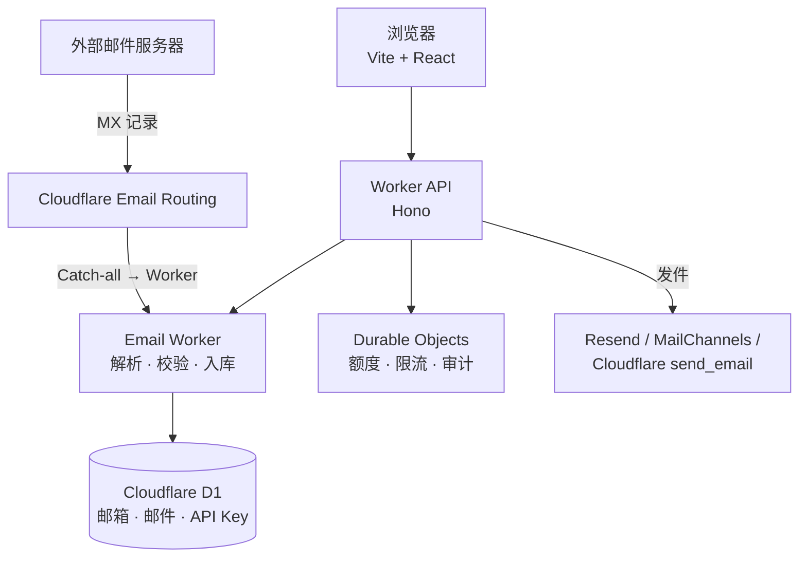

<div align="center">

# 𝐕𝐌𝐀𝐈𝐋.𝐃𝐄𝐕

**基于 Cloudflare Email Worker 的临时电子邮件服务**

一次性邮箱 · 邮件收发 · 开放 API · 无需服务器

[](LICENSE)
[](CHANGELOG.md)
[](package.json)
[](https://workers.cloudflare.com/)
[](https://github.com/PIKACHUIM/vmail/stargazers)

[一键部署](#-一键部署) · [部署教程](docs/github-action-tutorial.md) · [AI 帮忙部署](docs/ai-deploy.md) · [API 文档](https://vmail.dev/api-docs) · [English](README_en.md)

</div>

> [!IMPORTANT]
> **v3.2.1 升级必读**：[升级指南](docs/UPGRADE.md)。旧匿名 API Key、旧邮箱密码及分页协议发生变化。部署前运行 `pnpm setup:check`，配置邮箱签名密钥、OAuth 和首个管理员。
>
> 版本变更见 [CHANGELOG](CHANGELOG.md)。

---

## 🚀 一键部署

<div align="center">

<a href="https://deploy.workers.cloudflare.com/?url=https://github.com/PIKACHUIM/vmail"></a>&nbsp;
<a href="https://edgeone.ai/pages/new?repository-url=https%3A%2F%2Fgithub.com%2FPIKACHUIM%2Fvmail&project-name=vmail&install-command=pnpm%20install&build-command=pnpm%20run%20build&output-directory=frontend%2Fbuild%2Fclient"></a>&nbsp;
<a href="https://esa.console.aliyun.com/"></a>

</div>

| 平台                   | 能部署什么                          | 一键部署行为                                                         |
| ---------------------- | ----------------------------------- | -------------------------------------------------------------------- |
| **Cloudflare Workers** | 全部功能：收信、D1 存储、发件、限流 | Fork 仓库，自动创建 D1 / Durable Objects 并绑定，接入 Workers Builds |
| **腾讯 EdgeOne Pages** | 仅前端静态站点                      | 导入仓库，按下方参数构建 `frontend/build/client`                     |
| **阿里云 ESA Pages**   | 仅前端静态站点                      | 打开 ESA 控制台，导入 GitHub 仓库并构建                              |

> [!WARNING]
> 收信依赖 Cloudflare **Email Routing**，存储依赖 **D1**，额度与限流依赖 **Durable Objects**。
> EdgeOne Pages 与 ESA Pages 只能托管前端静态资源，部署后可以浏览界面，但**无法收信、登录和持久化邮件**。需要完整功能请走 Cloudflare Workers 方案，另两个平台适合做前端预览或全球加速。

### ① Cloudflare Workers（推荐，完整功能）

1. 点击上方 **Deploy to Cloudflare Workers**，登录 GitHub 与 Cloudflare。
   Cloudflare 会复制仓库到你自己的 GitHub 账号，并自动创建 D1、Durable Objects 等资源。
2. 在部署配置页填写构建与部署命令，并补全环境变量（至少 `EMAIL_DOMAIN`、三个签名密钥；完整清单见[环境变量](#-环境变量)）。
   一键部署只会自动绑定资源，**不会**替你生成密钥与 OAuth 凭据。
3. 部署完成后在本地对照 `.env` 执行校验：

   ```bash
   cp .env.example .env    # 填写 D1 / 域名 / 密钥
   pnpm install --frozen-lockfile
   pnpm setup:check
   ```

4. 在 Cloudflare 控制台的邮箱域名下配置 **Email Routing → Catch-all → Send to a Worker**，指向本 Worker。
   若自动绑定未生效（例如仓库内 `wrangler.toml` 仍是占位符），按[手动部署](#-自部署教程)填写 D1 ID 后执行 `pnpm deploy`。

### ② 腾讯 EdgeOne Pages（前端静态托管）

点击 **Deploy to EdgeOne Pages**，仓库与构建参数已预填：

| 配置项   | 值                      |
| -------- | ----------------------- |
| 安装命令 | `pnpm install`          |
| 构建命令 | `pnpm run build`        |
| 输出目录 | `frontend/build/client` |

构建产物是纯静态 React SPA，`/api/*` 请求需指向已部署的 Cloudflare Worker（可自行改写为反代或自定义 API 域名）。平台文档：[Deploy Button](https://pages.edgeone.ai/document/deploy-button)。

### ③ 阿里云 ESA Pages（前端静态托管）

点击 **Deploy to ESA Pages** 进入 ESA 控制台，依次选择 **边缘计算 → 函数和 Pages → 创建 → 导入 GitHub 仓库**，然后填写：

| 配置项       | 值                        |
| ------------ | ------------------------- |
| 安装命令     | `pnpm install`            |
| 构建命令     | `pnpm run build`          |
| 静态资源目录 | `./frontend/build/client` |
| 未匹配策略   | `singlePageApplication`   |

也可在仓库根目录添加 `esa.jsonc` 固化上述配置。平台文档：[快速入门](https://help.aliyun.com/document_detail/2982903.html)。

---

## 🌈 特点

- 🎯 匿名创建和接收邮箱；发件与 API Key 需登录
- ✈️ 支持邮件收发
- ✨ 支持保存服务端签发的邮箱凭证，恢复未过期邮箱
- 😄 支持多域名后缀
- 🔌 **开放 RESTful API**，支持程序化调用
- 🛡️ 内置额度、限流、封禁与发件审计
- 🚀 快速部署，纯 Cloudflare 方案，无需服务器

### 工作原理



- **接信**：Email Worker 接收电子邮件
- **展示**：前端（Vite + React）显示电子邮件
- **存储**：邮件与账户数据落在 Cloudflare D1
- **发信**：Resend API、MailChannels API 或 Cloudflare 原生发件

---

## 🖼️ 控制台预览

登录后可分别管理 API Key、邮箱、邮件和账户信息。管理员拥有独立的用户管理、调用日志、发件管理和部署配置页面。控制台默认深色，可切换浅色并记住选择；[API 文档](https://vmail.dev/api-docs) 无需登录。

以下为本地演示账号的实际界面，不包含真实用户资料或访问密钥。

| 首页                          | 深色控制台                                    |
| ----------------------------- | --------------------------------------------- |
|  |  |

| 发件弹框                            | 管理员发件管理                                    |
| ----------------------------------- | ------------------------------------------------- |
|  |  |

<details>
<summary>查看浅色主题与移动端</summary>


</details>

---

## 👋 自部署教程

本项目基于 Cloudflare Workers 和 Cloudflare D1 构建。您只需要一个托管在 Cloudflare 上的域名即可。

### 准备工作

- [Cloudflare](https://dash.cloudflare.com/) 账户与托管在 Cloudflare 上的域名
- 本地安装 [Node.js](https://nodejs.org) 环境（版本 >= 22.x）和 [pnpm](https://pnpm.io/installation)
- 至少一个 OAuth Provider（GitHub / Google），用于登录、API Key 和网页发件

### 自动部署（推荐）

本项目已包含一个预先配置好的 GitHub Action 工作流，可以帮助您自动将 Vmail 应用部署到 Cloudflare。

详细步骤请参考 [GitHub Action 自动部署教程](docs/github-action-tutorial.md)。

### 手动部署

1. 克隆仓库并安装依赖：

   ```bash
   git clone https://github.com/PIKACHUIM/vmail
   cd vmail
   pnpm install --frozen-lockfile
   cp .env.example .env
   ```

2. 在 Cloudflare 创建 D1，将名称、ID、邮箱域名和密钥填入 `.env`。部署凭据使用 `CLOUDFLARE_API_TOKEN` / `CLOUDFLARE_ACCOUNT_ID`（兼容 `CF_API_TOKEN` / `CF_ACCOUNT_ID`），也可先运行 `pnpm exec wrangler login`。API Token 需有部署 Worker 和迁移 D1 的权限。

3. 根据下表配置 OAuth 回调、首个管理员和所需功能，然后执行：

   ```bash
   pnpm setup:check
   pnpm deploy
   ```

   脚本会校验、测试、类型检查、构建、应用 D1 迁移并部署 Worker/静态资源和 Durable Objects。保留源文件 `wrangler.toml` 的占位符；脚本生成被 Git 忽略且不含密钥的 `wrangler.deploy.toml`，密钥随部署单独上传。Cloudflare Pages 的变量不用于本 Workers 项目。

4. 配置站点自定义域名与 `BETTER_AUTH_URL` 一致。在邮箱域名的 Email Routing 中启用 Catch-all → Send to a Worker，指向本 Worker，按向导设置 DNS。

---

## ⚙️ 环境变量

配置源为 [.env.example](.env.example) 和 [scripts/configure.mjs](scripts/configure.mjs)。手动部署使用未提交的 `.env`；GitHub Actions 使用仓库 Secrets/Variables，完整映射见[自动部署教程](docs/github-action-tutorial.md)。Cloudflare 控制台临时修改可能在下一次部署时被配置源覆盖。

### 基础配置

| 变量                                | 说明                                                                              |
| ----------------------------------- | --------------------------------------------------------------------------------- |
| `D1_DATABASE_NAME`/`D1_DATABASE_ID` | 必填；D1 名称和 ID，升级保留                                                      |
| `EMAIL_DOMAIN`                      | 必填；允许的邮箱域名，英文逗号分隔                                                |
| `MAILBOX_TOKEN_SECRET`              | 所有部署必填；独立随机密钥至少 32 字符，签名邮箱凭证，升级保留                    |
| `TURNSTILE_KEY`/`TURNSTILE_SECRET`  | 可选；必须同时配置或同时留空                                                      |
| `PASSWORD`                          | 可选站点访问密码；不能替代 OAuth 或邮箱凭证                                       |
| `SHOW_AFF`                          | 默认 false；true 显示推广弹框与链接                                               |
| `ENABLE_OPENAPI`                    | 默认 false；true 开放 /api/v1/\* 及创建 API Key；不影响公开文档，也不控制网页发件 |
| `SUSPEND_DATABASE_ACCESS`           | 默认 false；true 暂停 HTTP 数据库入口、入站邮件与清理，已排队统计可能继续写入     |

### OAuth 与管理员

| 变量                                      | 说明                                                                                                  |
| ----------------------------------------- | ----------------------------------------------------------------------------------------------------- |
| `BETTER_AUTH_URL`                         | HTTPS 站点 origin，例如 https://mail.example.com，不带路径；本地 .dev.vars 可用 http://localhost:8787 |
| `BETTER_AUTH_SECRET`                      | 登录会话签名密钥，独立随机值至少 32 字符                                                              |
| `API_KEY_SECRET`                          | API Key 签名密钥，独立随机值至少 32 字符；轮换使已有 Key 失效                                         |
| `GITHUB_CLIENT_ID`/`GITHUB_CLIENT_SECRET` | GitHub OAuth App 凭据；Actions 中使用 GH_OAUTH_CLIENT_ID / GH_OAUTH_CLIENT_SECRET                     |
| `GOOGLE_CLIENT_ID`/`GOOGLE_CLIENT_SECRET` | Google OAuth Web application 凭据                                                                     |
| `ADMIN_EMAILS`                            | 可选；逗号分隔的 OAuth 已验证邮箱，设置首个管理员；其他注册用户默认 user                              |

登录、API Key 和网页发件需要完整 OAuth 配置（两个 Provider 均需配置），即使暂不开放 API。`ENABLE_OPENAPI=true` 时部署检查会强制校验。匿名创建和接收邮箱无需 OAuth。

| Provider | 回调地址                                            |
| -------- | --------------------------------------------------- |
| GitHub   | `https://mail.example.com/api/auth/callback/github` |
| Google   | `https://mail.example.com/api/auth/callback/google` |

将示例域名替换为 `BETTER_AUTH_URL`。Google 的 Authorized JavaScript origins 填站点 origin；Testing 状态需添加测试用户。首个管理员将自己的已验证邮箱填入 `ADMIN_EMAILS` 后登录，进入 `/dashboard/admin/users`。不会自动把首位注册者设为管理员。

### 额度与费用控制

| 变量                            | 默认值 | 作用                                                    |
| ------------------------------- | ------ | ------------------------------------------------------- |
| `API_RATE_LIMIT_PER_MINUTE`     | 30     | 每用户 API 请求/分钟，所有 Key 共用                     |
| `API_DAILY_LIMIT`               | 1000   | 每用户 API 请求/天                                      |
| `MAILBOX_DAILY_LIMIT`           | 20     | 每用户通过 API 创建邮箱/天                              |
| `MAX_ACTIVE_MAILBOXES`          | 20     | 每用户有效邮箱上限                                      |
| `GLOBAL_API_DAILY_LIMIT`        | 100000 | 全站 HTTP 数据库路径日额度，含网页与认证；16 个固定分片 |
| `GLOBAL_INBOUND_DAILY_LIMIT`    | 100000 | 全站每日入站邮件预算；16 个固定分片                     |
| `MAILBOX_INBOUND_DAILY_LIMIT`   | 100    | 每邮箱每日入站邮件数                                    |
| `MAX_EMAIL_BYTES`               | 262144 | 单封入站邮件最大字节数（256 KiB）                       |
| `SEND_USER_DAILY_LIMIT`         | 10     | 每用户每日发件尝试数，跨邮箱共用                        |
| `SEND_GLOBAL_DAILY_LIMIT`       | 100    | 全站每日发件尝试数，独立于入站预算                      |
| `SEND_RATE_LIMIT_PER_MINUTE`    | 3      | 每用户及每邮箱每分钟发件数（运行时最高 1000）           |
| `SEND_IP_RATE_LIMIT_PER_MINUTE` | 10     | 每 IP 每分钟发件数（运行时最高 1000）                   |

数值配置必须为正整数。每日额度在 UTC 00:00（北京时间 08:00）重置。每用户最多 **3 个有效 API Key**，Key 有效期 90 天，数量上限不是环境变量。匿名网页另外受每 IP 每天 20 次创建、3000 次请求，以及每邮箱每分钟 30 次/每天 3000 次请求约束。全站分片预算可能在繁忙分片提前耗尽；这些额度不等于 Cloudflare 账单硬封顶。

### 发件配置

| 变量                   | 说明                                                                    |
| ---------------------- | ----------------------------------------------------------------------- |
| `SEND_CHANNEL`         | 留空关闭发件；resend / mailchannels / cloudflare；send_email 是旧兼容值 |
| `SENDER_EMAIL`         | 启用发件时必填；服务商允许的固定发件地址，临时邮箱作为 Reply-To         |
| `RESEND_API_KEY`       | 仅 resend 渠道必填                                                      |
| `MAILCHANNELS_API_KEY` | 仅 mailchannels 渠道必填                                                |

发件仅限登录且未封禁用户，需要有效邮箱凭证。服务商失败也占用额度；先在 Durable Objects 中校验额度，再写入 D1 发件记录。用户查看 `/dashboard/outbound`，管理员查看全站 `/dashboard/admin/outbound`。Cloudflare 原生发件使用 `SEND_EMAIL` 绑定，需配置 Email Routing 并满足 Cloudflare 的收件地址/发件权限要求；不保证可向任意地址发件。

`COOKIES_SECRET` 是旧版前端邮箱密码机制的遗留配置，当前部署脚本不使用它，新部署无需填写。三个签名密钥不能互相替代。

---

## 🔨 本地运行调试

使用独立测试密钥；Wrangler 本地变量放 `.dev.vars`，部署脚本变量放 `.env`，两者不要混用。

```bash
cp .dev.vars.example .dev.vars
# Fill local signing secrets before starting.
pnpm exec wrangler d1 migrations apply DB --local
pnpm dev
```

访问 `http://localhost:8787`。`pnpm dev` 会构建前端并由 Wrangler 提供静态资源，不会同时启动 Vite 热更新；需要热更新时在第二个终端运行 `pnpm frontend:dev`。OAuth/发件验证使用 8787 同源入口及匹配的本地回调。默认模拟本地 D1/DO，无需为本地模拟创建远程数据库。`pnpm setup:check` 读取部署用 `.env`；代码检查用 `pnpm test` 和 `pnpm typecheck`。

---

## 📖 API 文档

Vmail 提供完整的 RESTful API，支持通过程序化方式创建临时邮箱、查询收件箱。

### 获取 API Key

[API 文档](https://vmail.dev/api-docs) 匿名可读；使用 GitHub / Google 登录后，在[控制台](https://vmail.dev/dashboard/keys)创建免费 API Key。自部署实例需先开启 `ENABLE_OPENAPI=true`。

### API 端点

| 方法     | 端点                                        | 说明                   |
| -------- | ------------------------------------------- | ---------------------- |
| `POST`   | `/api/v1/mailboxes`                         | 创建临时邮箱           |
| `GET`    | `/api/v1/mailboxes/:id`                     | 获取邮箱信息           |
| `GET`    | `/api/v1/mailboxes/:id/messages`            | 获取收件箱（支持分页） |
| `GET`    | `/api/v1/mailboxes/:id/messages/:messageId` | 获取邮件详情           |
| `DELETE` | `/api/v1/mailboxes/:id/messages/:messageId` | 删除邮件               |

### 快速开始

```bash
# 1. 创建临时邮箱
curl -X POST https://vmail.dev/api/v1/mailboxes \
  -H "X-API-Key: your-api-key" \
  -H "Content-Type: application/json"

# 响应: { "data": { "id": "abc123", "address": "random@domain.com", ... } }

# 2. 查询收件箱
curl https://vmail.dev/api/v1/mailboxes/abc123/messages \
  -H "X-API-Key: your-api-key"

# 3. 获取邮件详情
curl https://vmail.dev/api/v1/mailboxes/abc123/messages/msg_001 \
  -H "X-API-Key: your-api-key"
```

完整文档请访问：[https://vmail.dev/api-docs](https://vmail.dev/api-docs)

---

## 🛡️ 发件权限、额度与审计

升级后 `/api/send` 必须同时携带登录会话、有效邮箱凭证和本站 Origin；匿名邮箱持有人须先登录。被封禁用户不能发件，也不能使用其他用户绑定的邮箱。

新增 `SEND_USER_DAILY_LIMIT=10`、`SEND_GLOBAL_DAILY_LIMIT=100`，可用环境变量调整。用户额度跨邮箱共用；发送尝试（包括服务商失败）扣减额度，UTC 零点重置。原有邮箱/IP 分钟限速保留，邮箱分钟限速也用于用户。额度在 Durable Objects 中原子预留，达到上限后不会请求邮件服务商。

部署前应用 `0006_outbound_logs.sql`（自动部署脚本会执行迁移）。用户在 `/dashboard/outbound` 查看自己的邮件，管理员在 `/dashboard/admin/outbound` 查看全站发件并按用户筛选。保存主题、正文、收发地址与结果，保留 30 天，每小时清理过期记录。HTML 正文隔离显示且不加载远程资源。成功仅表示服务商已接收；处理中也可能表示结果未确认，请勿自动重发。

---

## 🧩 相关项目

- [Nbility Gen](https://gen.nbility.ai) - AI 生图/视频站
- [AttachReady](https://attachready.com) - 支持 API 与 MCP 调用的图片、PDF 转换与处理工具集
- [KeepVideo](https://keep.video) - YouTube、Instagram 等平台桌面视频下载器

> 🌟 推荐 **Claude Code** 稳定 API 渠道：[Nbility AI Gateway](https://nbility.ai/auth/register?aff=Dptp) ，支持 Claude Fable 5、GPT 5.6 等主流 AI Coding 大模型

---

## 📝 License

GNU General Public License v3.0 · 本项目基于 [oiov/vmail](https://github.com/oiov/vmail) 二次开发，遵循上游授权。

## Star History

[](https://star-history.com/#PIKACHUIM/vmail&Date)
